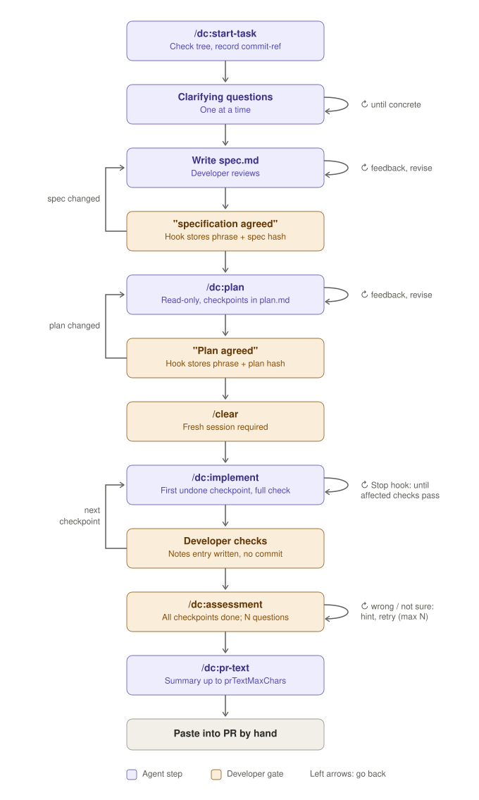

# DC-Harness

DC-Harness is a plugin for coding agents that makes agent-assisted development consistent across teams while the developer keeps the knowledge of what was built. Its philosophy is "controlled but appealing". The control comes from a few human gates that need the developer's own words: the interview answers, the approval of the specifications, the approval of the plan, and a short assessment on the final diff. Everything else stays light. Developers are trusted, not monitored: artefacts stay on their machine and the only thing shared is a short PR text pasted into the pull request. The scope is one task per branch, from the task description to the PR text. Git stays in the developer's hands, there is no CI gate, and general engineering advice (TDD, review, security) is reused from existing skill libraries instead of rewritten.



- [Installation](#installation): Claude Code on Windows (devs).
- [Onboarding](#onboarding): set a project repo up for the harness (tech lead).
- [Plugin setup](#plugin-setup): enable the plugin in an onboarded repo (devs, once per repo).
- [Usage](#usage): run a task (devs).

## Installation

Claude Code CLI installation in Windows PowerShell:

1. Install Claude Code

   ```powershell
   irm https://claude.ai/install.ps1 | iex
   ```

2. Add Claude Code to the `PATH`

   ```powershell
   [Environment]::SetEnvironmentVariable("Path", [Environment]::GetEnvironmentVariable("Path", "User") + ";$env:USERPROFILE\.local\bin", "User")
   ```

3. Close the terminal and open a new one, so the new `PATH` applies.

4. Install the tools the harness needs: [Git for Windows](https://git-scm.com/download/win) (it brings Git Bash) and `jq` 1.8 or later:

   ```powershell
   winget install jqlang.jq
   ```

> Note: The harness scripts run in Git Bash. From PowerShell, call it by its full path (`& "C:\Program Files\Git\bin\bash.exe" …`): a bare `bash` may start WSL instead.

## Onboarding

Done once per project repo by the tech lead. It creates the `.harness/` folder, which only the tech lead changes.

1. Clone this repo containin the harness

   ```sh
   git clone https://github.com/migarbo1/DC-Harness.git <destination>
   ```

2. Run the doctor script, and fix anything it reports as failed

   ```sh
   bash "<destination>/plugins/dc-harness/scripts/doctor.sh"
   ```

3. Onboard the project. Run it from the project's root folder where the DC-Harness is desired to be onboarded:

   ```sh
   bash "<destination>/scripts/onboard-repo.sh" --marketplace "<destination>" .
   ```

   It writes `.harness/config.json` and `.harness/AGENTS.md`, adds the line `@.harness/AGENTS.md` to `CLAUDE.md`, adds `.tasks/` to `.gitignore`, and registers the plugin in `.claude/settings.json`. Use the harness repo's URL as `--marketplace` once it is published, so teammates don't need a local clone.

4. Choose the stacks. Set `stack` in `.harness/config.json` to the stacks of the repo, in the order their checks run:

   | Stack | For | Checks |
   | --- | --- | --- |
   | `python` | Python | ruff, mypy, pytest |
   | `angular` | Angular 21–22, TypeScript | ESLint 9, `tsc`, `ng test` (Vitest) |
   | `java` | Spring Boot 2 or 3, Java 17 or 21, Gradle | compile, `gradlew test` |

   A repo with a frontend and a backend side by side sets the folder of each stack with `dir`:

   ```json
   "stack": ["angular", "java"],
   "stackCommands": { "angular": { "dir": "frontend" }, "java": { "dir": "backend" } }
   ```

5. (optional) Override stack checks. Set in `stackCommands` only the commands that differ from the defaults; `null` skips a check.

   ```json
   "stackCommands": { "python": { "lint": ".venv/Scripts/python.exe -m ruff check . && .venv/Scripts/python.exe -m ruff format --check .", "types": ".venv/Scripts/python.exe -m mypy", "tests": ".venv/Scripts/python.exe -m pytest" } }
   ```

   > Note: This is mandatory for Python if the project uses a virtual environment: the harness doesn't activate it.

   Other common overrides:

   | Case | Override |
   | --- | --- |
   | Angular with Karma / Jasmine | `"angular": { "tests": "npx ng test --watch=false --browsers=ChromeHeadless" }` |
   | Angular with Jest | `"angular": { "tests": "npx jest" }` |
   | Java with Checkstyle or Spotless | `"java": { "lint": "./gradlew checkstyleMain spotlessCheck --console=plain -q" }` |
   | Java with Maven | `"java": { "types": "./mvnw -B -q test-compile", "tests": "./mvnw -B test" }` |

   The full list of keys (approval phrases, protected branches, assessment questions and pass threshold, PR text length) is in [docs/contracts.md](docs/contracts.md) §1.

6. Commit the onboarding on the develop branch

   ```sh
   git add .harness CLAUDE.md .gitignore .claude/settings.json
   git commit -m "chore: onboard DC-Harness"
   git push
   ```

## Plugin setup

Done once per onboarded repo by every developer.

1. Pull the branch with the onboarding commit.

2. Start Claude Code in the project's root folder

   ```sh
   claude
   ```

3. Trust the folder, and accept installing the `dc` plugin from the `dc-harness` marketplace when Claude Code asks. If it doesn't ask, install it by hand:

   ```sh
   claude plugin marketplace add "<destination>" --scope project
   claude plugin install dc@dc-harness --scope project
   ```

4. Check the plugin is loaded: type `/dc:` and the five commands appear. On a protected branch, `/dc:start-task test` refuses with `Branch <branch> is protected. Create a task branch first.`

## Usage

One task per branch. The task's files live in `.tasks/<branch>/`: they are gitignored and stay on your machine. Only the PR text leaves it, when you paste it.

1. Create a task branch from a clean working tree (no changes and no untracked files)

   ```sh
   git switch -c feature/<task-name>
   ```

2. Start the task with its description

   ```text
   /dc:start-task <description of the task>
   ```

   The agent explores the code, asks questions one at a time, each with its own guess, and writes `spec.md`. Review it and ask for changes until it is right.

3. Approve the spec. Type the approval phrase on its own, nothing else in the message:

   ```text
   Specification agreed
   ```

4. Plan the task

   ```text
   /dc:plan
   ```

   The agent writes `plan.md`, split into checkpoints (`CP1`, `CP2`, …). It doesn't change any code in this step. Review the plan, then approve it with the phrase on its own:

   ```text
   Plan agreed
   ```

5. Start a new session, then implement the first checkpoint

   ```text
   /clear
   /dc:implement
   ```

   The agent builds one checkpoint, runs the checks, writes its entry in `implementation-notes.md` and stops. Review the changes (`git diff`, `git status`), then run `/dc:implement` again for each remaining checkpoint. No `/clear` is needed between checkpoints.

6. Take the assessment

   ```text
   /dc:assessment
   ```

   The agent asks a few questions about the changes, one at a time. Answer in your own words; "not sure" is a fine answer. Your answers are recorded word for word, and the score goes into the PR text.

7. Write the PR text

   ```text
   /dc:pr-text
   ```

   The agent writes `.tasks/<branch>/pr-text.md`, within the project's character limit. This finishes the task.

8. Commit, push and open the PR yourself, and paste the contents of `pr-text.md` into the PR description.

> Note: The approval phrases are the project's own (`specApprovalPhrase` and `planApprovalPhrase` in `.harness/config.json`). They count only when typed alone, in any case: "Plan agreed, but rename X" or a pasted phrase is not an approval. If `spec.md` or `plan.md` changes after approval, type the phrase again.

### Rules

- Don't commit, merge or rebase while a task is open: the assessment diff is taken from the commit where the task started.
- Every check must pass. During `/dc:implement`, the harness doesn't let the agent finish a turn until lint, types and the affected tests pass. If a check can't pass for a reason the agent can't fix (a database or service that is down, a missing tool), press **Esc** to interrupt it.
- One task open at a time per repo. To abandon a task, delete its `.tasks/<branch>/` folder.
- When a command refuses, it prints one line with the reason and what to do next. Do that and run the command again.

### Commands

| Command | When | Writes |
| --- | --- | --- |
| `/dc:start-task <description>` | On a new, clean task branch | `spec.md` |
| `/dc:plan` | After the spec approval phrase | `plan.md` |
| `/dc:implement [<checkpoint>]` | After the plan approval phrase and `/clear`; once per checkpoint | code, tests, `implementation-notes.md` |
| `/dc:assessment` | When every checkpoint is done | `assessment.md` |
| `/dc:pr-text` | After the assessment; can be run again to regenerate the text | `pr-text.md` |
